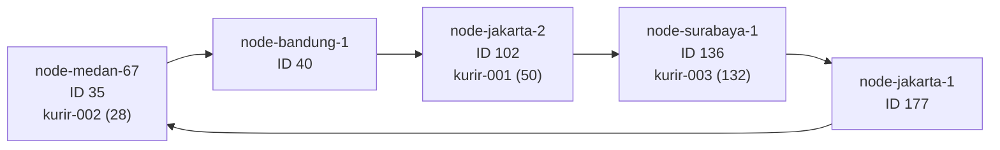

# Tugas 6 — Penamaan dan Resolusi Lokasi

## Analisis FoodGo

ID kurir bersifat tetap sedangkan alamat IP berubah ketika kurir berpindah jaringan. Karena itu, aplikasi memakai ID kurir sebagai nama stabil dan memperbarui pasangan ID→IP saat kurir mendaftar ulang. Dengan Chord, hash ID kurir menentukan node penanggung jawab; pencarian tidak bergantung pada satu tabel pusat yang menjadi bottleneck sekaligus titik gagal tunggal. Saat node berubah, hanya sebagian rentang key yang perlu berpindah ke successor baru.

Tabel pusat dengan flat naming memang mudah dicari, tetapi semua pembaruan dan lookup bergantung pada server pusat. DNS memberi nama yang lebih mudah diingat dan mendukung cache serta delegasi, tetapi untuk kasus ini tetap memerlukan pengelolaan zona dan pembaruan record; cache juga dapat menyimpan alamat lama sampai TTL berakhir. DHT cocok untuk pemetaan terdistribusi yang diperbarui dan dicari oleh banyak node tanpa satu koordinator tunggal. Simulasi ini menunjukkan prinsip pembagian tanggung jawab; implementasi produksi tetap perlu menangani replikasi, kegagalan node, autentikasi, dan propagasi pembaruan IP.

## Ring Chord dari simulasi

Hash memakai SHA-1 yang dipotong modulo 256 (`m=8`). Setiap node bertanggung jawab atas key dengan hash setelah predecessor-nya sampai dengan ID node tersebut (interval `(predecessor, node]`).

Diagram menggambarkan keadaan setelah node Medan bergabung dan sebelum node Jakarta-2 keluar. Kurir-002 berpindah dari node 40 ke node 35 pada saat join. Ring kembali setelah leave terdiri atas node 35, 40, 136, dan 177. Hash lengkap key: `kurir-001=50`, `kurir-002=28`, `kurir-003=132`.

## Penelusuran manual `lookup("kurir-001")`

1. Program menghitung `hash_id("kurir-001") = 50` pada ruang 0–255.
2. Sebelum leave, node tersusun berdasarkan ID: 35, 40, 102, 136, 177.
3. `find_successor(50)` memeriksa ID terurut dan mengambil ID pertama yang ≥ 50, yaitu 102.
4. Record hash 50 berisi `("kurir-001", "192.168.1.10")`; lookup mengembalikan `192.168.1.10`.
5. Setelah node 102 keluar, successor pertama ≥ 50 adalah 136. Tanggung jawab berpindah ke node 136, sementara lookup tetap mengembalikan IP kurir yang sama.

Contoh wrap-around: bila hash key lebih besar daripada ID node terbesar, successor adalah node ber-ID terkecil.

## Perubahan topologi

Node baru `node-medan-67` memiliki ID 35. Sebelum bergabung, hash kurir-002 (28) ditangani node 40. Setelah join, successor pertama ≥ 28 adalah node 35, maka tanggung jawab berpindah dari 40 ke 35. Selanjutnya node `node-jakarta-2` (ID 102) keluar. Key kurir-001 (50) yang sebelumnya ditangani node 102 kini menjadi tanggung jawab successor berikutnya, node 136.