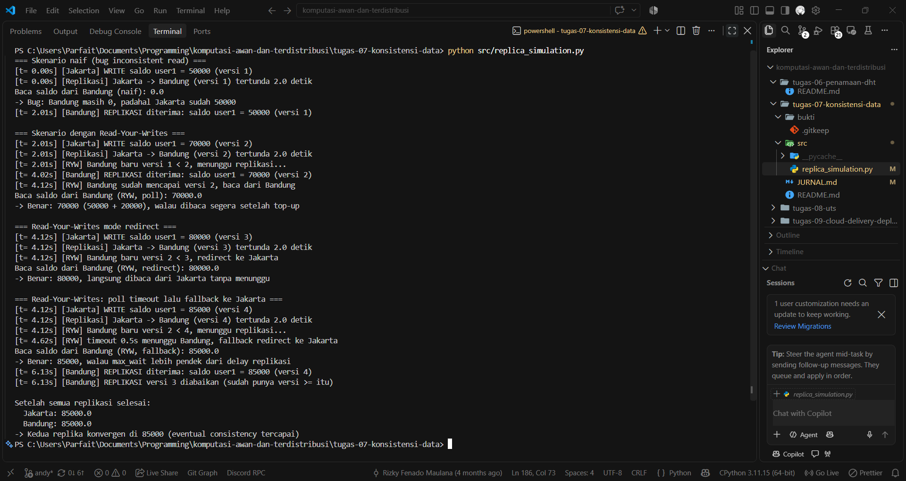

# Jurnal Proses — Tugas 7

## Diskusi pemilihan model konsistensi
- **Argumen yang dipertimbangkan:**
  - Saldo *e-wallet* adalah data finansial. Pembacaan *stale* bisa menolak transaksi yang sebenarnya sah, atau meloloskan transaksi melebihi saldo jika validasi dilakukan di replika yang tertinggal.
  - *Eventual consistency* masih berguna untuk data tidak kritis, misalnya jumlah *like*, rekomendasi restoran, atau jumlah tayangan. Keterlambatan sementara di sana tidak menimbulkan kerugian langsung.
  - Urutan operasi saldo (`top-up`, pembayaran, *refund*, penarikan) harus sama di semua replika. Jika urutannya berbeda, saldo akhir bisa berbeda.
  - Replikasi asinkron dari primary ke replika yang dibaca client hanya memberi *eventual consistency*. Client yang baru menulis bisa membaca replika yang belum menerima tulisannya.
  - Karena itu dipakai *client-centric consistency*, yaitu **Read-Your-Writes (RYW)**. RYW lebih lemah dari sequential consistency, tetapi cukup untuk kasus ini dan lebih murah diterapkan.
  - RYW hanya memperbaiki sisi baca. Penulisan saldo tetap harus diserialisasi di primary agar dua request pada wallet yang sama (misalnya dua perangkat) tidak saling menimpa.

- **Kesimpulan akhir & alasan:**
  - **Eventual consistency saja tidak cukup** untuk saldo. Dampak bisnisnya besar: transaksi sah ditolak, saldo tidak cocok, kepercayaan pengguna turun.
  - Model yang dipilih: **penulisan saldo diserialisasi di primary (Jakarta)**, ditambah **Read-Your-Writes** untuk pembacaan dari replika.
  - RYW diimplementasikan dengan **versi penulisan**. Setiap penulisan menghasilkan nomor versi baru (penomoran global yang monoton), dan replika menyimpan versi terakhir **per pengguna**. Client menyimpan versi dari penulisan terakhirnya sendiri. Saat membaca dari replika, replika hanya melayani jika versinya >= versi client. Jika belum, ada dua pilihan: menunggu replikasi (*poll*) atau *redirect* ke Jakarta. Jika *poll* melewati batas waktu, sistem *fallback* ke Jakarta.

## Simulasi
- Dijalankan dengan `python src/replica_simulation.py`. Semua `assert` lolos. Output lengkap ada di `bukti/output.txt`.
- **Perbaikan di `main()`:** versi awal mengasumsikan saldo 50000 padahal tidak ada top-up awal (0 + 20000 ≠ 70000), sehingga `AssertionError`. Kami menambahkan skenario naif di awal, yang sekaligus menunjukkan bug *inconsistent read*.

- **Hasil:**

| Skenario | Hasil | Keterangan |
|---|---|---|
| Naif | 0.0 | Top-up 50000 ke Jakarta (versi 1), Bandung dibaca langsung (t=0.00s), sebelum replikasi 2 detik selesai. Bug terlihat. |
| RYW (poll) | 70000.0 | Bandung versi 1 < 2, menunggu ±2 detik sampai versi 2 tiba, lalu membaca 70000. |
| RYW (redirect) | 80000.0 | Bandung versi 2 < 3, langsung dialihkan ke Jakarta tanpa menunggu. |
| RYW (poll timeout) | 85000.0 | `max_wait` 0.5s lebih pendek dari delay replikasi, sehingga *fallback* ke Jakarta. |
| Akhir | 85000 = 85000 | Jakarta dan Bandung konvergen (*eventual consistency* tercapai). |

- **Mekanisme di kode:** `top_up()` mengembalikan nomor versi sebagai token. `baca_saldo_read_your_writes()` membaca saldo dan versi secara atomik lewat `snapshot()`. `replicate()` mengabaikan update bernomor versi lebih lama (terlihat di log "versi 3 diabaikan"), sehingga replikasi yang terlambat tidak menimpa data baru.
- **Trade-off:** mode *poll* menambah latensi baca (±2 detik pada skenario ini). Mode *redirect* dan *fallback* menambah beban ke Jakarta dan membuatnya jadi titik ketergantungan.
- **Batasan simulasi:** hanya satu pengguna, tanpa operasi debit/pembayaran, tanpa kegagalan Jakarta atau replikasi yang hilang. Serialisasi penulisan hanya dibuktikan lewat `_lock`, belum lewat uji konkuren.

## Log Penggunaan AI (Level 2)

> Wajib diisi sesuai kebijakan Level 2 di [`../RUBRIK-UMUM.md`](../RUBRIK-UMUM.md). Tulis "Tidak memakai AI" pada baris pertama jika memang tidak dipakai. Hanya untuk brainstorming ide/outline — bukan untuk kode/analisis/teks akhir.

| Tanggal | Tool AI | Prompt yang diberikan | Ringkasan saran/ide AI | Bagaimana diolah jadi tulisan/kode sendiri |
|---|---|---|---|---|
