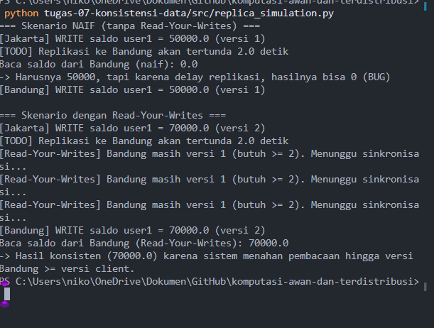

# Jurnal Proses — Tugas 7

## Diskusi pemilihan model konsistensi
- **Argumen yang dipertimbangkan:**
1. *Evaluasi Eventual Consistency Murni (Dampak Risiko Bisnis yang Tinggi)*: Dari sisi infrastruktur, Eventual Consistency memberikan keunggulan berupa waktu respons yang cepat dan tingkat ketersediaan layanan (high availability) karena setiap node dapat memproses permintaan secara mandiri tanpa menunggu sinkronisasi menyeluruh. Meskipun demikian, pendekatan ini menciptakan jeda waktu replikasi (replication lag) yang menyebabkan ketidaksinkronan data saldo sementara antara server Jakarta dan Bandung. Untuk layanan keuangan krusial seperti e-wallet FoodGo, keterlambatan sinkronisasi beberapa detik saja berpotensi memunculkan inconsistent read. Dampaknya, pengguna yang baru mengisi saldo (top-up) lewat server Jakarta bisa mengalami kegagalan pembayaran saat memesan makanan melalui server Bandung, meskipun dana sebenarnya sudah masuk. Secara bisnis, kondisi ini sangat merugikan karena dapat menggerus kepercayaan pelanggan, memicu lonjakan keluhan ke layanan pelanggan, mendorong pengguna beralih ke platform pesaing, hingga membuka celah double-spending saat terjadi transaksi bersamaan. Situasi ini jauh lebih sensitif dibandingkan fitur non-finansial seperti jumlah like pada media sosial, di mana selisih angka sementara tidak merugikan pengguna maupun menghambat fungsi utama aplikasi.
  2. *Evaluasi Sequential Consistency Global (Beban Performa yang Berat):* Sebaliknya, penerapan Sequential Consistency secara global memastikan seluruh server replika mencatat urutan transaksi secara identik, sehingga masalah perbedaan saldo antar wilayah dapat dicegah sepenuhnya. Namun, jaminan ketertiban global ini mewajibkan adanya koordinasi, konsensus, dan penguncian data (locking) lintas lokasi pada setiap operasi penulisan (write). Pada aplikasi pesan-antar makanan dengan trafik tinggi, proses sinkronisasi ketat antara pusat data Jakarta dan Bandung akan memicu antrean jaringan (bottleneck), memperlambat waktu muat aplikasi, menurunkan kapasitas pemrosesan transaksi (throughput), serta membuat sistem rentan mengalami gangguan apabila koneksi antar wilayah tidak stabil.

- **Kesimpulan akhir & alasan:** 
Menimbang keseimbangan antara akurasi data dan kecepatan sistem, solusi paling ideal untuk e-wallet FoodGo adalah memadukan Eventual Consistency pada tingkat sinkronisasi antar server dengan jaminan Client-Centric Consistency melalui mekanisme Read-Your-Writes (yang dapat diperkuat dengan Monotonic Reads).

Arsitektur hibrida ini dipilih karena mampu menjembatani kebutuhan teknis dan kepuasan pengguna secara optimal:

- Mempertahankan Kecepatan dan Skalabilitas: Proses penyelarasan data antar pusat data tetap berjalan di balik layar secara asinkron tanpa beban penguncian global (global locking), sehingga aplikasi tetap responsif dan tangguh menghadapi lonjakan pesanan pada jam sibuk.   

- Menjamin Konsistensi pada Sisi Pengguna: Melalui penerapan Read-Your-Writes (seperti pencatatan version vector atau write timestamp pada sesi pengguna), sistem memastikan setiap pelanggan yang baru memperbarui saldonya di server Jakarta akan langsung melihat nominal terbaru saat melakukan transaksi berikutnya. Hal ini dapat dicapai dengan mengarahkan permintaan baca sementara ke server yang sudah termutakhirkan, atau menunda pembacaan di server Bandung sejenak hingga versi datanya menyamai timestamp transaksi terakhir pengguna. Cara ini efektif mencegah kegagalan pembayaran akibat data usang tanpa mengorbankan performa sistem secara keseluruhan.

## Simulasi (jika dikerjakan)
- **Hasil skenario naif vs Read-Your-Writes:**
  - **Skenario Naif:** Setelah pelanggan melakukan *top-up* sebesar `50000` di server Jakarta dan langsung melakukan pembacaan ke server Bandung dalam jeda `0.5` detik (lebih cepat dari `REPLICATION_DELAY` sebesar `2.0` detik), server Bandung mengembalikan saldo lama sebesar `0.0` (*stale read*).
  - **Skenario Read-Your-Writes:** Setelah *top-up* kedua sebesar `20000` (total saldo menjadi `70000.0`, versi `2`), klien menyertakan parameter `versi_minimal` saat membaca saldo dari server Bandung. Server Bandung mendeteksi bahwa metadata `last_write_version` lokalnya (`1`) tertinggal dari versi klien (`2`), sehingga sistem melakukan *polling* dan menahan pembacaan hingga replikasi asinkron selesai. Hasilnya, saldo yang dikembalikan konsisten sebesar `70000.0`.

Bukti Menjalankan Simulasi:

## Log Penggunaan AI (Level 2)

> Wajib diisi sesuai kebijakan Level 2 di [`../RUBRIK-UMUM.md`](../RUBRIK-UMUM.md). Tulis "Tidak memakai AI" pada baris pertama jika memang tidak dipakai. Hanya untuk brainstorming ide/outline — bukan untuk kode/analisis/teks akhir.

| Tanggal | Tool AI | Prompt yang diberikan | Ringkasan saran/ide AI | Bagaimana diolah jadi tulisan/kode sendiri |
|---|---|---|---|---|
| 16/11/2026 | Gemini | "Jelaskan konsep model konsistensi data (Sequential, Eventual, dan Client-Centric Consistency) serta penerapannya pada studi kasus nyata dan kebutuhan simulasi replikasi server e-wallet." | Menjelaskan perbedaan antara *data-centric consistency* (*Sequential* vs *Eventual*) dan *client-centric consistency* (*Read-Your-Writes*), dampak bisnis *stale read* pada sistem pembayaran dibanding media sosial, serta konsep pelacakan versi data antar replika dalam simulasi. | Menggunakan pemahaman konsep *Read-Your-Writes* dan mekanisme perbandingan versi data tersebut sebagai dasar penyusunan argumen analisis pemilihan model konsistensi dan logika pengecekan versi pada simulasi replikasi Jakarta–Bandung. |