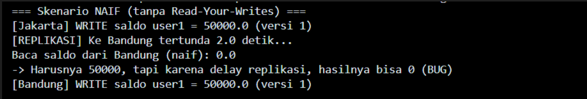
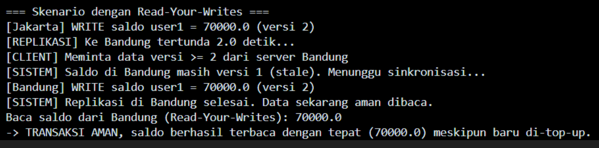

# Jurnal Proses — Tugas 7

## Diskusi pemilihan model konsistensi
- Argumen yang dipertimbangkan:
Sistem FoodGo menggunakan dua server replika, yaitu Jakarta dan Bandung. Ketika pelanggan melakukan top-up, perubahan saldo langsung disimpan pada server Jakarta, sedangkan server Bandung menerima pembaruan setelah jeda waktu 2 detik. Model Eventual Consistency dipertimbangkan karena tidak mengharuskan semua replika memiliki data yang sama secara langsung. Namun, model ini memiliki kelemahan, yaitu pelanggan berpotensi membaca saldo lama ketika berpindah server sebelum proses replikasi selesai. Oleh karena itu, dipilih pendekatan Client-Centric Consistency dengan menerapkan Read-Your-Writes agar pelanggan tetap dapat membaca hasil pembaruan yang telah dilakukan sebelumnya.

- Kesimpulan akhir & alasan:
Model yang digunakan adalah Eventual Consistency dengan mekanisme Read-Your-Writes sebagai solusi dari sisi klien. Pemilihan ini didasarkan pada kebutuhan sistem FoodGo yang memungkinkan replikasi data berlangsung secara bertahap, tetapi tetap harus memastikan pelanggan mendapatkan informasi saldo terbaru setelah melakukan transaksi. Dengan mekanisme Read-Your-Writes, sistem memeriksa versi data pada server tujuan dan menunggu sampai versi yang dibutuhkan tersedia sebelum menampilkan saldo kepada pelanggan.

## Simulasi (jika dikerjakan)
- Hasil skenario naif vs Read-Your-Writes:

### Skenario Naif
Pada skenario ini, pelanggan melakukan top-up sebesar Rp50.000 melalui server Jakarta. Namun, pelanggan langsung membaca saldo melalui server Bandung sebelum proses replikasi selesai.

Hasil Pengujian

Analisis
Server Bandung masih menyimpan saldo awal sebesar Rp0 karena belum menerima pembaruan dari server Jakarta. Kondisi ini disebut stale read, yaitu ketika pengguna membaca data yang belum diperbarui.

### Skenario Read-Your-Writes
Skenario ini, pelanggan melakukan top-up tambahan sebesar Rp20.000. Sistem kemudian memeriksa versi data sebelum mengembalikan hasil pembacaan saldo dari server Bandung.

Hasil Pengujian

Analisis
Versi data pada server Bandung masih lebih rendah daripada versi minimal yang dibutuhkan. Oleh karena itu, sistem melakukan polling setiap 0,5 detik hingga replikasi selesai. Setelah versi data sesuai, saldo berhasil dibaca sebesar Rp70.000.

## Log Penggunaan AI (Level 2)

> Wajib diisi sesuai kebijakan Level 2 di [`../RUBRIK-UMUM.md`](../RUBRIK-UMUM.md). Tulis "Tidak memakai AI" pada baris pertama jika memang tidak dipakai. Hanya untuk brainstorming ide/outline — bukan untuk kode/analisis/teks akhir.

| Tanggal | Tool AI | Prompt yang diberikan | Ringkasan saran/ide AI | Bagaimana diolah jadi tulisan/kode sendiri |
|---|---|---|---|---|
| ... | ... | ... | ... | ... |
