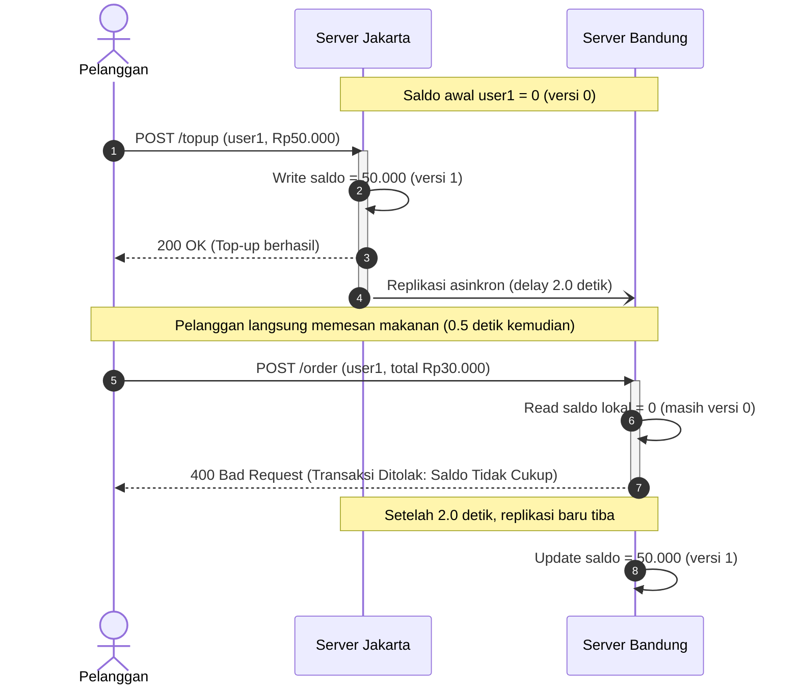
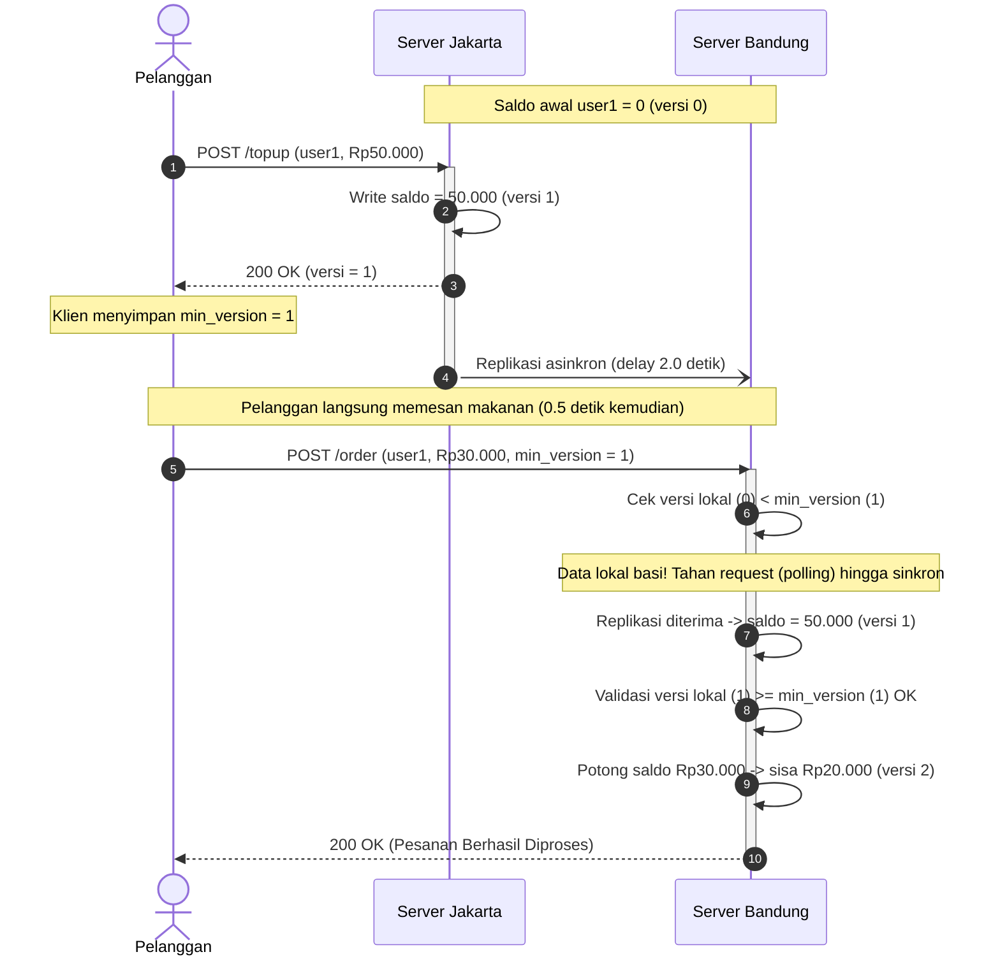

# Tugas 7 (Pekan 7) — Konsistensi Data

**Materi terkait:** Data-Centric Consistency (Sequential, Eventual), Client-Centric Consistency.

## Studi Kasus

Data saldo *e-wallet* pelanggan FoodGo berbeda antara server wilayah **Jakarta** dan **Bandung** karena replikasi antar server berjalan lambat. Contoh kasus nyata: pelanggan top-up saldo lewat server Jakarta, lalu dalam hitungan detik memesan makanan lewat aplikasi yang tersambung ke server Bandung — saldo belum ter-update, transaksi ditolak padahal saldo sebenarnya cukup.

## Tugas Kelompok

### Bagian 1 — Analisis (wajib)

1. Tentukan: apakah kasus ini **membutuhkan Sequential Consistency** (semua replika melihat urutan operasi yang sama) atau **cukup Eventual Consistency** (replika akan konsisten "pada akhirnya", boleh sementara berbeda)? Berikan argumen berbasis dampak bisnis (mis. kasus saldo *e-wallet* jauh lebih sensitif dibanding kasus "jumlah like" di media sosial).
2. Jika kalian menyimpulkan Eventual Consistency saja **tidak cukup** untuk skenario ini, usulkan pendekatan **Client-Centric Consistency** yang relevan (mis. *Read-Your-Writes*: pelanggan yang baru top-up harus selalu melihat saldo terbarunya sendiri, walau replika lain belum sinkron).
3. Gambarkan **diagram alir urutan (sequence diagram)** yang menunjukkan operasi read/write antara pelanggan, server Jakarta, server Bandung, dan proses replikasi — untuk skenario **tanpa** jaminan konsistensi (bug terjadi) DAN skenario **dengan** solusi yang kalian usulkan (bug teratasi). Pakai Mermaid (`sequenceDiagram`) di `README.md` — lihat contoh cara pakai di Tugas 2.

### Bagian 2 — Simulasi (opsional, nilai tambah)

Skeleton `src/replica_simulation.py` mensimulasikan dua replika (Jakarta & Bandung) dengan delay replikasi buatan. Lengkapi TODO untuk:
1. Menunjukkan kondisi **inconsistent read** (replika Bandung masih menunjukkan saldo lama walau Jakarta sudah update).
2. Mengimplementasikan mekanisme **Read-Your-Writes** sederhana (mis. dengan version/timestamp per client) yang memperbaiki masalah tersebut.

```bash
python3 src/replica_simulation.py
```


## Jawaban Hasil Analisis:

Bagian Niko
### 1. Analisis Pemilihan Model Konsistensi

### Apakah Eventual Consistency Saja Cukup?
**Tidak cukup.** Pada replikasi antarwilayah (Jakarta dan Bandung), *Eventual Consistency* murni memang memberikan latensi tulis yang rendah dan ketersediaan tinggi (*high availability*), tetapi mengizinkan adanya jeda waktu (*inconsistency window*) di mana dua server menyimpan nilai saldo yang berbeda.

Jika dilihat dari **dampak bisnis nyata**, toleransi terhadap data basi pasti bergantung dengan jenis domain aplikasinya:
* **Fitur Non-Transaksional (Contoh: Jumlah *Like* Media Sosial):** Jika pengguna A menyukai sebuah unggahan dan pengguna B melihat angka *like* tertinggal selama 2 detik, tidak ada kerugian finansial maupun kegagalan alur bisnis. *Eventual Consistency* saja sudah cukup.
* **Sistem Finansial (*E-Wallet* FoodGo):** Saldo dompet digital adalah data transaksional data yang sensitif. Ketika pelanggan melakukan *top-up* di server Jakarta lalu langsung memesan makanan melalui server Bandung dalam hitungan detik, pembacaan saldo lama (*stale read*) menyebabkan transaksi ditolak (*false rejection*) meskipun dana sebenarnya sudah masuk. Dampak bisnisnya fatal: transaksi gagal terjadi (potensi pendapatan hilang), pengguna bisa panik karena saldo dianggap raib, dan tingkat kepercayaan pelanggan terhadap keamanan finansial aplikasi menurun drastis.

### Mengapa Tidak Menggunakan Strict Sequential Consistency Secara Global?
Menerapkan *Sequential Consistency* yang ketat di seluruh replika mengharuskan setiap operasi baca/tulis dikunci dan disinkronkan secara serentak lintas wilayah sebelum transaksi dianggap sah. Pendekatan ini menciptakan *bottleneck* jaringan dan menurunkan ketersediaan layanan (*availability*) apabila koneksi antar-datacenter Jakarta–Bandung mengalami latensi tinggi.

FoodGo tetap mempertahankan replikasi asinkron (*Eventual Consistency*) di lapisan penyimpanan antar-server untuk menjaga performa, tetapi melapisinya dengan jaminan **Client-Centric Consistency** agar pengalaman transaksi setiap individu tetap konsisten.

---

Bagian Liel
### 2. Usulan Solusi: Client-Centric Consistency (*Read-Your-Writes*)

Untuk menutup bug *inconsistent read* tanpa mengorbankan performa global, sistem menerapkan model **Read-Your-Writes Consistency**. Model ini menjamin bahwa setelah seorang pelanggan berhasil memperbarui datanya sendiri (operasi *write*), setiap pembacaan berikutnya (operasi *read*) oleh pelanggan tersebut akan selalu melihat hasil pembaruan terakhirnya, meskipun permintaan dialihkan ke server replika lain.

### Mekanisme Implementasi Konkret
1. **Pelacakan Versi Data (*Monotonic Versioning*):** Setiap replika menyimpan metadata versi terakhir untuk setiap pengguna (`last_write_version[user_id]`). Setiap kali terjadi operasi *top-up* di server Jakarta, nilai versi dinaikkan secara berurutan (`version += 1`).
2. **Penyimpanan State di Sisi Klien:** Setelah operasi *top-up* berhasil, server Jakarta mengembalikan respons sukses beserta nomor versi terbaru (misalnya `version = 1`) ke aplikasi pelanggan. Aplikasi klien menyimpan nilai ini sebagai `min_version`.
3. **Validasi Versi Saat Pembacaan (*Version Check*):** Ketika pelanggan berpindah koneksi ke server Bandung untuk memesan makanan, aplikasi klien menyertakan `min_version` pada parameter/header permintaan *read*. Server Bandung membandingkan versi lokalnya dengan `min_version` dari klien:
   * Jika `versi_lokal >= min_version`, server Bandung langsung mengembalikan data saldo.
   * Jika `versi_lokal < min_version` (replikasi dari Jakarta belum tiba), server Bandung **menahan respons sementara (*polling/wait*)** hingga proses replikasi selesai memperbarui data lokal, atau **meneruskan permintaan (*redirect*)** langsung ke server Jakarta yang memiliki data terbaru.

---

## 3. Diagram Alir Urutan (*Sequence Diagram*)

### A. Skenario Tanpa Jaminan Konsistensi (Bug Terjadi)


### B. Skenario Dengan Solusi Read-Your-Writes (Bug diatasi


## Struktur Submission

```
tugas-07-konsistensi-data/
├── README.md      # Analisis konsistensi + sequence diagram Mermaid
├── JURNAL.md
├── src/            # (opsional) simulasi replikasi
└── bukti/          # (jika mengerjakan simulasi) output program
```

## Rubrik Penilaian (Tugas 7)

| Komponen | Bobot | Kriteria |
|---|---|---|
| Ketepatan pemilihan model konsistensi | 30% | Argumen berbasis dampak bisnis nyata, bukan hafalan definisi |
| Kualitas sequence diagram | 30% | Menunjukkan jelas titik kegagalan & titik perbaikan |
| Usulan solusi client-centric | 25% | Solusi konkret dan dapat diimplementasikan (bukan wacana abstrak) |
| Proses & kontribusi kelompok | 15% | `JURNAL.md`, commit history (+ bonus jika simulasi dikerjakan) |

## Batasan Penggunaan AI (Level 2)

Kebijakan **Level 2 (AI Assisted Idea Generation & Structuring)** berlaku — lihat [`../RUBRIK-UMUM.md`](../RUBRIK-UMUM.md). Boleh bertanya konsep umum consistency model ke AI untuk brainstorming; **tidak boleh** meminta AI menuliskan analisis akhir/sequence diagram atau isi `# TODO` di `src/replica_simulation.py` yang tinggal ditempel. Catat pemakaian AI di "Log Penggunaan AI" pada `JURNAL.md`.

- Sebagai bukti pemahaman konsep (bukan hafalan jawaban skenario FoodGo saja), `README.md` wajib menyertakan **satu skenario tambahan** yang kalian buat sendiri (mis. kasus lain di aplikasi ojek online) dan menentukan model konsistensi yang tepat untuk skenario tambahan tersebut.
