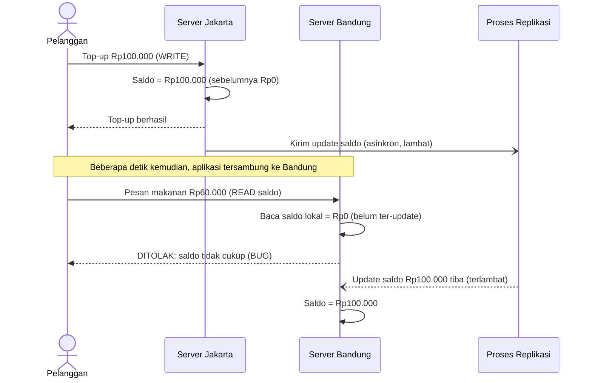
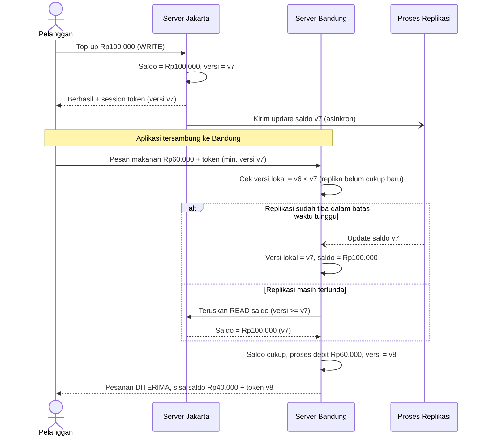
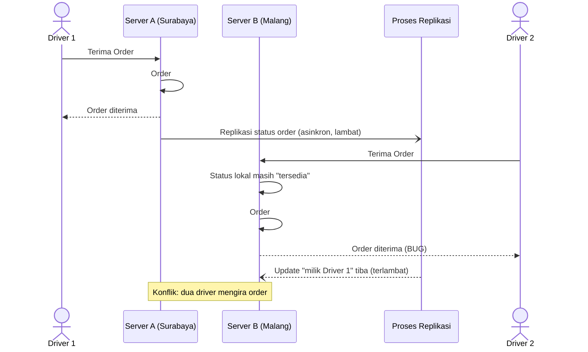
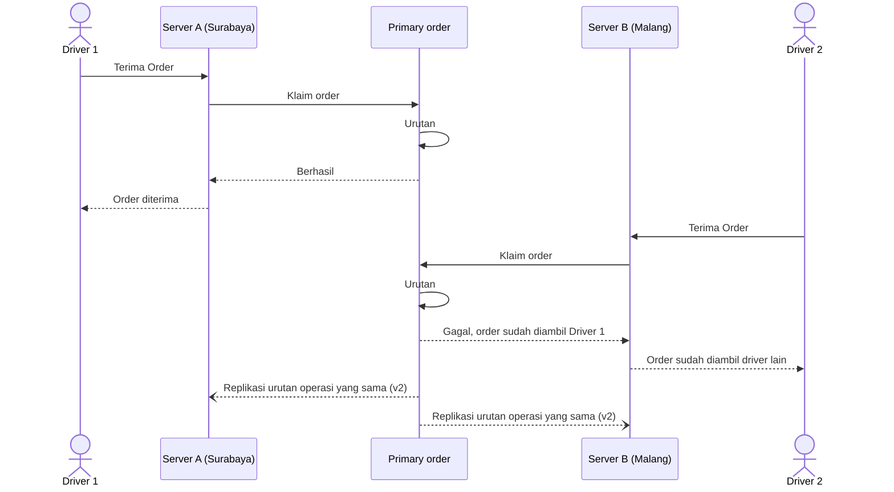

# Studi Kasus FoodGo — Konsistensi Saldo E-Wallet

## Bagian 1 — Analisis

### 1. Sequential Consistency atau Eventual Consistency?

**Kesimpulan: kasus saldo e-wallet membutuhkan Sequential Consistency (untuk operasi pada data saldo). Eventual Consistency saja tidak cukup.**

Argumen berbasis dampak bisnis:

| Aspek | Dampak jika saldo hanya Eventual Consistency |
|---|---|
| **Kepercayaan pelanggan** | Pelanggan baru saja top-up (uangnya sudah terpotong dari rekening), tetapi pesanan ditolak karena "saldo tidak cukup". Ini terlihat seperti uang hilang dan sangat merusak kepercayaan. |
| **Kehilangan pendapatan** | Setiap transaksi yang ditolak karena data basi adalah penjualan yang gagal, dan pelanggan bisa pindah ke kompetitor. |
| **Beban operasional** | Lonjakan komplain ke customer service, proses refund/investigasi manual, dan reputasi buruk di app store. |
| **Risiko finansial (lebih berbahaya)** | Replikasi lambat bisa terjadi ke arah sebaliknya: saldo sudah dipakai di Jakarta, tetapi Bandung masih melihat saldo lama, sehingga pelanggan bisa membayar dua kali dengan saldo yang sama (*double spending*) dan saldo menjadi negatif. |
| **Kepatuhan** | Data keuangan harus dapat diaudit dan urutan transaksinya harus jelas. |

Pembanding: pada kasus "jumlah like" di media sosial, angka yang tertinggal beberapa detik tidak merugikan siapa pun, sehingga Eventual Consistency sudah cukup. Pada saldo, **kesalahan membaca berarti kesalahan keputusan uang**.

Mengapa **Sequential Consistency** (bukan sekadar eventual): semua replika harus melihat urutan operasi yang sama pada saldo (misalnya `top-up +50.000` lalu `bayar -35.000`). Dengan begitu tidak ada replika yang memproses `bayar` seolah-olah `top-up` belum terjadi.

Trade-off (CAP/latensi): menjaga urutan yang sama lintas kota menambah latensi karena tulis saldo harus dikoordinasikan (misalnya lewat primary per akun atau quorum). Untuk saldo, harga ini layak dibayar (pilih **C** dibanding **A** saat terjadi partisi). Untuk data non-kritis seperti rating, rekomendasi, dan jumlah pesanan, FoodGo tetap boleh memakai Eventual Consistency agar cepat dan tersedia.

### 2. Pendekatan Client-Centric Consistency yang relevan

Jika Eventual Consistency tidak cukup, kombinasi jaminan sisi klien yang diusulkan:

- **Read-Your-Writes (utama)**: pelanggan yang baru top-up selalu melihat saldo terbarunya sendiri, walaupun replika Bandung belum sinkron.
- **Monotonic Reads (pendukung)**: setelah pelanggan melihat saldo versi N, pembacaan berikutnya tidak boleh menampilkan versi yang lebih lama dari N (saldo tidak "mundur" saat berpindah server).

Cara implementasi (sederhana):

1. Setiap write saldo menghasilkan **versi/timestamp (version token)** yang dikembalikan ke klien.
2. Klien menyertakan token itu pada setiap request berikutnya (*session token*).
3. Server yang menerima request hanya melayani jika replikanya sudah mencapai versi tersebut. Jika belum, server **menunggu replikasi** sebentar atau **meneruskan (forward) pembacaan ke server yang sudah punya data** (misalnya Jakarta).

Catatan: Read-Your-Writes memperbaiki bug pada skenario ini. Untuk mencegah double spending antar-sesi, operasi **debit** tetap harus melewati penulisan yang berurutan (satu primary per akun), sesuai jawaban nomor 1.

### 3. Sequence Diagram

#### a. Tanpa jaminan konsistensi (bug terjadi)

#### b. Dengan solusi Read-Your-Writes (bug teratasi)

---

## Bagian 2 — Skenario Tambahan: Aplikasi Ojek Online ("OjekGo")

### Deskripsi skenario

OjekGo menjalankan dua server regional, **Server A (Surabaya)** dan **Server B (Malang)**, dengan replikasi antar server yang berjalan lambat. Seorang penumpang memesan ojek. Order yang sama ditampilkan ke beberapa driver di sekitar lokasi penjemputan, yang aplikasinya bisa tersambung ke server yang berbeda.

Kasus nyata: **Driver 1** menekan "Terima Order" lewat Server A. Dalam hitungan detik, **Driver 2** (tersambung ke Server B) juga melihat order itu masih berstatus "tersedia" karena replikasi belum sampai, lalu menekan "Terima Order". Akibatnya satu order diterima dua driver: penumpang bingung, salah satu driver datang percuma, dan pendapatan serta reputasi aplikasi dirugikan.

Data di aplikasi ini punya tingkat sensitivitas berbeda, sehingga model konsistensinya pun tidak sama:

| Data | Sensitivitas | Model konsistensi yang tepat | Alasan |
|---|---|---|---|
| **Penugasan driver ke order** (siapa yang menerima order) | Tinggi | **Sequential Consistency** (semua replika melihat urutan "terima order" yang sama, yang pertama menang) | Satu order hanya boleh dimiliki satu driver. Jika urutan operasi berbeda antar replika, terjadi *double assignment*. |
| **Status order di layar penumpang** (mencari driver → driver ditemukan → dalam perjalanan → selesai) | Menengah | **Client-Centric: Monotonic Reads** | Status tidak boleh "mundur" bagi penumpang, misalnya sudah melihat "driver ditemukan" lalu pindah server dan melihat "mencari driver" lagi. |
| **Riwayat/order yang baru saja dibuat penumpang** | Menengah | **Client-Centric: Read-Your-Writes** | Penumpang yang baru memesan harus langsung melihat ordernya di aplikasi, walaupun replika lain belum sinkron. |
| **Posisi driver di peta** (titik yang bergerak) | Rendah | **Eventual Consistency** | Lokasi berubah tiap detik dan selalu ditimpa data baru. Tertinggal 1–3 detik tidak berbahaya dan mengutamakan kecepatan dan ketersediaan. |
| **Rating dan jumlah order selesai driver** | Rendah | **Eventual Consistency** | Selisih sementara tidak berdampak ke transaksi. |

### Model konsistensi utama yang dipilih: Sequential Consistency untuk penugasan driver

**Argumen berbasis dampak bisnis:**

- **Kepuasan penumpang:** dua driver menuju titik yang sama membuat penumpang bingung dan membatalkan order.
- **Kepuasan dan penghasilan driver:** driver yang kalah "balapan" sudah menempuh perjalanan dan menolak order lain, sehingga waktu dan bensinnya terbuang. Driver bisa keluar dari platform.
- **Biaya operasional:** dibutuhkan kompensasi/insentif dan penanganan komplain manual.
- **Eventual Consistency tidak cukup**, karena pada fase "replika belum sinkron" itulah bug terjadi, dan konflik tidak bisa diperbaiki setelah kedua driver sudah berangkat.

**Trade-off:** operasi "terima order" harus dikoordinasikan (misalnya lewat satu *primary* per order atau *compare-and-set* dengan versi), sehingga latensinya sedikit lebih tinggi. Hal ini dapat diterima karena operasi ini hanya terjadi sekali per order, sedangkan data lokasi yang sangat sering berubah tidak ikut dikoordinasikan.

### Sequence diagram

#### a. Tanpa jaminan konsistensi (bug: satu order diterima dua driver)

#### b. Dengan Sequential Consistency (bug teratasi)

