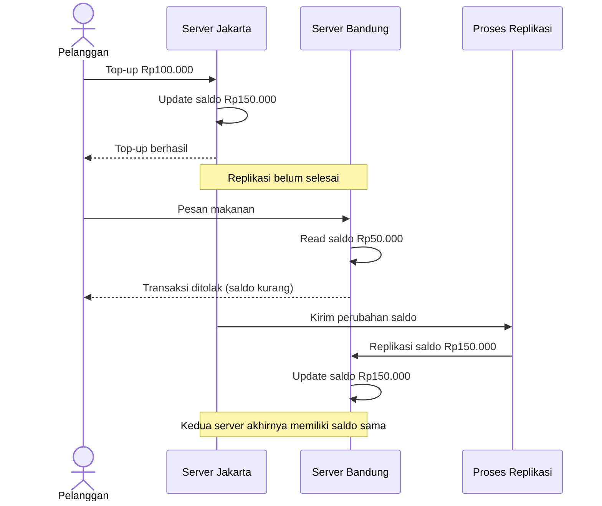
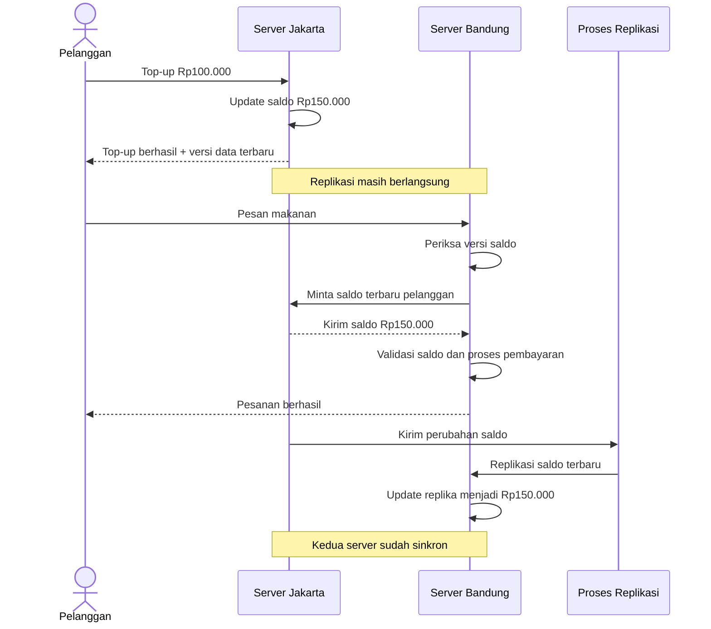

# Tugas 7 (Pekan 7) — Konsistensi Data

**Materi terkait:** Data-Centric Consistency (Sequential, Eventual), Client-Centric Consistency.

## Studi Kasus

Data saldo *e-wallet* pelanggan FoodGo berbeda antara server wilayah **Jakarta** dan **Bandung** karena replikasi antar server berjalan lambat. Contoh kasus nyata: pelanggan top-up saldo lewat server Jakarta, lalu dalam hitungan detik memesan makanan lewat aplikasi yang tersambung ke server Bandung — saldo belum ter-update, transaksi ditolak padahal saldo sebenarnya cukup.

## Tugas Kelompok

### Bagian 1 — Analisis (wajib)

1. Tentukan: apakah kasus ini **membutuhkan Sequential Consistency** (semua replika melihat urutan operasi yang sama) atau **cukup Eventual Consistency** (replika akan konsisten "pada akhirnya", boleh sementara berbeda)? Berikan argumen berbasis dampak bisnis (mis. kasus saldo *e-wallet* jauh lebih sensitif dibanding kasus "jumlah like" di media sosial).

Jawab :

Kasus FoodGo lebih membutuhkan Sequential Consistency dibandingkan Eventual Consistency, karena data saldo e-wallet berkaitan langsung dengan transaksi keuangan pelanggan.

Alasannya berdasarkan dampak bisnis:

- Mencegah kesalahan transaksi. Jika menggunakan Eventual Consistency, server Jakarta dan Bandung boleh memiliki data saldo yang berbeda untuk sementara. Akibatnya, pelanggan bisa mengalami penolakan transaksi meskipun saldo sebenarnya mencukupi.
- Menjaga kepercayaan pelanggan. Saldo merupakan uang milik pelanggan. Jika informasi saldo tidak konsisten, pelanggan dapat merasa dirugikan dan kehilangan kepercayaan terhadap FoodGo.
- Menghindari kerugian bisnis. Ketidaksesuaian saldo dapat menyebabkan transaksi gagal, keluhan pelanggan, dan meningkatnya biaya penanganan masalah.
- Berbeda dengan jumlah like media sosial. Jika jumlah like belum langsung diperbarui di semua server, dampaknya relatif kecil. Pengguna masih bisa melihat jumlah like yang berbeda sementara tanpa mengalami kerugian finansial.

---


2. Jika kalian menyimpulkan Eventual Consistency saja **tidak cukup** untuk skenario ini, usulkan pendekatan **Client-Centric Consistency** yang relevan (mis. *Read-Your-Writes*: pelanggan yang baru top-up harus selalu melihat saldo terbarunya sendiri, walau replika lain belum sinkron).

Jawab :

Untuk mengatasi masalah pada FoodGo, pendekatan yang dapat digunakan adalah Client-Centric Consistency dengan menerapkan Read-Your-Writes Consistency.
Pendekatan ini memastikan pelanggan dapat melihat hasil perubahan data yang sebelumnya dilakukan sendiri, meskipun proses replikasi ke server lain belum selesai.

Penerapan pada FoodGo:
1. Pelanggan melakukan top-up saldo melalui server Jakarta.
2. Server Jakarta berhasil menyimpan perubahan saldo pelanggan.
3. Ketika pelanggan membuka kembali saldo, sistem memastikan pelanggan membaca data saldo terbaru hasil top-up, bukan data lama dari server Bandung.
4. Server Jakarta dapat menyimpan versi atau timestamp dari saldo pelanggan, sehingga ketika pelanggan mengakses saldo, server dapat memeriksa versi terbaru dan menampilkan saldo yang sesuai.

Dengan cara ini, pelanggan akan selalu melihat saldo yang benar setelah melakukan top-up, meskipun server Bandung belum menerima update tersebut.

---

3. Gambarkan **diagram alir urutan (sequence diagram)** yang menunjukkan operasi read/write antara pelanggan, server Jakarta, server Bandung, dan proses replikasi — untuk skenario **tanpa** jaminan konsistensi (bug terjadi) DAN skenario **dengan** solusi yang kalian usulkan (bug teratasi). Pakai Mermaid (`sequenceDiagram`) di `README.md` — lihat contoh cara pakai di Tugas 2.

Jawab :

A. Skenario tanpa jaminan konsistensi (bug terjadi)



B. Skenario dengan solusi Read-Your-Writes (bug teratasi)


    
---

Skenario tambahan:

Studi Kasus :

Pada aplikasi ojek online, lokasi driver diperbarui secara berkala melalui GPS. Ketika driver bergerak, aplikasi mengirimkan informasi lokasi terbaru ke server. Namun, karena keterlambatan jaringan atau replikasi antarserver, pelanggan mungkin melihat lokasi driver yang sedikit tertinggal dari posisi sebenarnya.

Model konsistensi yang dipilih: Eventual Consistency

Alasan pemilihan:
1. Lokasi driver berubah secara terus-menerus sehingga tidak harus langsung diperbarui di semua server pada waktu yang sama.
2. Perbedaan lokasi selama beberapa detik masih dapat ditoleransi oleh pelanggan.
3. Data lokasi akan diperbarui secara berkala hingga seluruh replika memiliki informasi terbaru.
4. Menggunakan konsistensi yang terlalu kuat untuk setiap perubahan lokasi dapat menambah beban komunikasi antarserver dan memperlambat sistem.

---

### Bagian 2 — Simulasi (opsional, nilai tambah)

Skeleton `src/replica_simulation.py` mensimulasikan dua replika (Jakarta & Bandung) dengan delay replikasi buatan. Lengkapi TODO untuk:
1. Menunjukkan kondisi **inconsistent read** (replika Bandung masih menunjukkan saldo lama walau Jakarta sudah update).
2. Mengimplementasikan mekanisme **Read-Your-Writes** sederhana (mis. dengan version/timestamp per client) yang memperbaiki masalah tersebut.

```bash
python3 src/replica_simulation.py
```

## Struktur Submission

```
tugas-07-konsistensi-data/
├── README.md      # Analisis konsistensi + sequence diagram Mermaid
├── JURNAL.md
├── src/            # (opsional) simulasi replikasi
└── bukti/          # (jika mengerjakan simulasi) output program
```

## Rubrik Penilaian (Tugas 7)

| Komponen | Bobot | Kriteria |
|---|---|---|
| Ketepatan pemilihan model konsistensi | 30% | Argumen berbasis dampak bisnis nyata, bukan hafalan definisi |
| Kualitas sequence diagram | 30% | Menunjukkan jelas titik kegagalan & titik perbaikan |
| Usulan solusi client-centric | 25% | Solusi konkret dan dapat diimplementasikan (bukan wacana abstrak) |
| Proses & kontribusi kelompok | 15% | `JURNAL.md`, commit history (+ bonus jika simulasi dikerjakan) |

## Batasan Penggunaan AI (Level 2)

Kebijakan **Level 2 (AI Assisted Idea Generation & Structuring)** berlaku — lihat [`../RUBRIK-UMUM.md`](../RUBRIK-UMUM.md). Boleh bertanya konsep umum consistency model ke AI untuk brainstorming; **tidak boleh** meminta AI menuliskan analisis akhir/sequence diagram atau isi `# TODO` di `src/replica_simulation.py` yang tinggal ditempel. Catat pemakaian AI di "Log Penggunaan AI" pada `JURNAL.md`.

- Sebagai bukti pemahaman konsep (bukan hafalan jawaban skenario FoodGo saja), `README.md` wajib menyertakan **satu skenario tambahan** yang kalian buat sendiri (mis. kasus lain di aplikasi ojek online) dan menentukan model konsistensi yang tepat untuk skenario tambahan tersebut.
