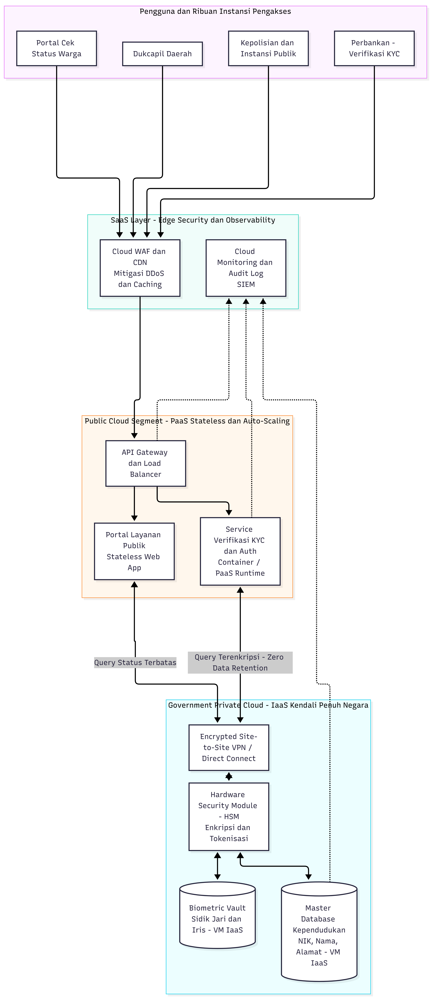

# Tugas 9 (Pekan 9) — Cloud Delivery & Deployment Model

**Materi terkait:** Karakteristik esensial cloud computing (NIST SP 800-145), Deployment Model (Public/Private/Hybrid/Community), Service Model (IaaS/PaaS/SaaS).

> Bagian 2 mata kuliah ini murni **analisis & desain di atas kertas** — tidak ada biaya cloud sama sekali, karena tugas berhenti di tahap rekomendasi, bukan implementasi nyata (implementasi baru mulai Tugas 11).

## Studi Kasus

Pemerintah ingin membangun **Sistem Data Kependudukan** (nama, NIK, alamat, data biometrik) yang:
- Sangat **rahasia** (data pribadi warga negara, diatur UU Perlindungan Data Pribadi).
- Diakses oleh **ribuan instansi** (dukcapil daerah, kepolisian, bank untuk verifikasi KYC) dengan pola akses yang **tidak rata** (lonjakan saat musim pemilu/pendaftaran sekolah).
- Butuh **skalabilitas** agar tidak downtime saat lonjakan akses, tapi **tidak boleh** datanya berada di infrastruktur yang tidak terkendali penuh oleh negara.

## Tugas Kelompok

1. **Rekomendasikan Deployment Model** (Public / Private / Hybrid / Community Cloud) yang paling tepat untuk sistem ini. Jelaskan alasannya berdasarkan **karakteristik NIST** (on-demand self-service, broad network access, resource pooling, rapid elasticity, measured service) dikaitkan dengan kebutuhan kerahasiaan vs skalabilitas.
2. **Rekomendasikan Service Model** (IaaS / PaaS / SaaS) yang tepat untuk komponen-komponen berbeda dari sistem ini (boleh berbeda service model untuk komponen berbeda, mis. database inti vs portal publik untuk pengecekan status).
3. Jelaskan **minimal 2 risiko spesifik** dari pilihan kalian dan mitigasinya (mis. jika Hybrid Cloud dipilih: risiko sinkronisasi data antara private & public segment).
4. Bandingkan singkat dengan **satu alternatif yang kalian tolak** — kenapa alternatif itu kurang tepat (mis. kenapa Public Cloud murni ditolak, atau kenapa Private Cloud murni dianggap kurang skalabel).

## Jawaban Kelompok
1. Berdasarkan hasil analisis kelompok kami, Private Cloud merupakan Cloud Deployment Model yang direkomendasikan untuk Sistem Data Kependudukan. Model ini dipilih karena sistem menyimpan data sensitif warga, seperti nama, NIK, alamat, dan biometrik, yang membutuhkan tingkat kerahasiaan serta kontrol tinggi. Private Cloud memungkinkan pemerintah mengelola infrastruktur, penyimpanan, jaringan, dan keamanan secara terpusat sesuai kebijakan pemerintah dan ketentuan UU Nomor 27 Tahun 2022 tentang Perlindungan Data Pribadi (UU PDP). Berdasarkan karakteristik NIST SP 800-145, Private Cloud tetap mendukung on-demand self-service melalui penyediaan resource sesuai kebutuhan layanan, broad network access melalui akses jaringan aman bagi instansi berwenang, dan resource pooling melalui penggunaan resource komputasi secara bersama. Rapid elasticity diterapkan dengan menambah kapasitas server saat terjadi lonjakan permintaan, seperti pada periode pemilu atau pendaftaran sekolah. Sementara itu, measured service digunakan untuk memantau penggunaan CPU, memori, storage, dan trafik jaringan agar kapasitas dapat dikelola secara efisien. Dengan demikian, kelompok kami menilai Private Cloud dapat menjaga kontrol data sekaligus mendukung skalabilitas, meskipun kapasitasnya tetap bergantung pada infrastruktur yang disediakan pemerintah.

2. Untuk Cloud Service Model, kelompok kami merekomendasikan kombinasi Infrastructure as a Service (IaaS) dan Platform as a Service (PaaS) sesuai kebutuhan masing-masing komponen sistem. IaaS digunakan untuk database utama yang menyimpan NIK, alamat, identitas, dan data biometrik karena membutuhkan kontrol terhadap server, sistem operasi, storage, jaringan, serta keamanan. Dengan IaaS, pemerintah dapat mengatur konfigurasi dan pembatasan akses database sesuai kebijakan keamanan internal. Sementara itu, PaaS digunakan untuk aplikasi backend, API verifikasi identitas, dan layanan integrasi dengan instansi seperti Dukcapil daerah, kepolisian, dan bank. PaaS mempermudah pengembangan serta pemeliharaan aplikasi tanpa harus mengelola seluruh infrastruktur dasar. Adapun SaaS tidak digunakan sebagai model utama karena pemerintah membutuhkan kontrol lebih besar terhadap aplikasi dan pemrosesan data sensitif. SaaS masih dapat dimanfaatkan untuk aplikasi pendukung yang tidak mengelola data kependudukan sensitif.

3.

4. Alternatif yang tidak dipilih oleh kelompok kami adalah Public Cloud murni. Model ini memiliki keunggulan dalam skalabilitas karena kapasitas resource dapat ditingkatkan sesuai kebutuhan. Namun, Sistem Data Kependudukan membutuhkan kontrol langsung pemerintah terhadap infrastruktur yang menyimpan data sensitif warga. Penggunaan Public Cloud murni memerlukan pengaturan dan pengawasan tambahan terkait pengelolaan infrastruktur, lokasi penyimpanan data, serta akses penyedia layanan. Oleh karena itu, kelompok kami lebih memilih Private Cloud karena memberikan kontrol pengelolaan infrastruktur yang lebih besar dan dapat disesuaikan dengan kebijakan keamanan pemerintah, meskipun membutuhkan investasi serta pengelolaan kapasitas secara mandiri.

## Bukti & Diagram Arsitektur


## Struktur Submission

```
tugas-09-cloud-delivery-deployment/
├── README.md      # Analisis lengkap (isi dengan poin 1-4 di atas)
├── JURNAL.md
└── bukti/          # (opsional) diagram pendukung
```

## Rubrik Penilaian (Tugas 9)

| Komponen | Bobot | Kriteria |
|---|---|---|
| Ketepatan rekomendasi deployment model | 30% | Argumen berbasis karakteristik NIST, bukan sekadar "private cloud lebih aman" tanpa detail |
| Ketepatan rekomendasi service model | 25% | Pemetaan komponen sistem ke IaaS/PaaS/SaaS masuk akal |
| Analisis risiko & mitigasi | 25% | Risiko spesifik ke konteks data kependudukan (bukan risiko generik) |
| Perbandingan dengan alternatif yang ditolak | 20% | Argumen penolakan jelas dan berdasar |

## Batasan Penggunaan AI (Level 2)

Kebijakan **Level 2 (AI Assisted Idea Generation & Structuring)** berlaku — lihat [`../RUBRIK-UMUM.md`](../RUBRIK-UMUM.md). Boleh bertanya ke AI gambaran umum karakteristik NIST/deployment model untuk brainstorming; **tidak boleh** meminta AI menuliskan rekomendasi/analisis akhir yang tinggal ditempel ke `README.md`. Catat pemakaian AI di "Log Penggunaan AI" pada `JURNAL.md`.

- Jawaban yang terasa seperti "template" (bisa dipakai untuk sistem cloud apa saja tanpa menyebut spesifik kependudukan/data pribadi/regulasi) akan dinilai rendah pada komponen ketepatan rekomendasi.
- `README.md` wajib membahas minimal satu skenario tandingan yang kalian buat sendiri (mis. "bagaimana jika instansi daerah tidak punya infrastruktur private cloud sendiri?") beserta jawabannya.
